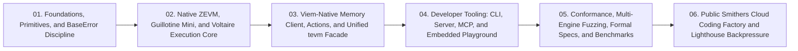

<!-- Generated from .smithers/history/mythical.json by scripts/factory/mythical-history.mjs --write. Do not hand-edit. -->

# TEVM Mythical History

The mythical history of TEVM: the clean, from-scratch epic story of today's tree, preserving architectural provenance and abandoned experiments as retained notes.

## 01. Foundations, Primitives, and BaseError Discipline

Establish the monorepo package structure, strict BaseError hierarchy, JSON-RPC envelope types, and canonical Ethereum utilities.

### Define @tevm/errors, @tevm/utils, and @tevm/common

- **Owning paths**: `packages/errors`, `packages/utils`, `packages/common`
- **Provenance**: `a02ceb108adf`
- **Design note**: Every public error extends BaseError with standard JSON-RPC negative codes and structured diagnostic context.

### Specify @tevm/jsonrpc and @tevm/http-client transport contracts

- **Owning paths**: `packages/jsonrpc`, `packages/http-client`, `packages/predeploys`
- **Provenance**: `a02ceb108adf`
- **Design note**: Canonical hex quantities, even-length data hex, and explicit JSON-serializable wire contracts.

**Retained notes on superseded experiments:**

- Legacy JS-only EthereumJS state/vm wrappers were superseded by native ZEVM execution for performance and Ethereum Execution Spec parity.

## 02. Native ZEVM, Guillotine Mini, and Voltaire Execution Core

Power @tevm/node with the native Zig ZEVM engine, pinned sibling revisions, content-addressed addon stamps, and isolated node lifecycles.

### Wire @tevm/node to native @evmts/zevm with deterministic addon stamping

- **Owning paths**: `packages/node`, `factory/native-dependencies.json`, `scripts/factory/build-native.mjs`
- **Provenance**: `96ac87a7300a`, `b696b586f33c`
- **Design note**: Native addon bytes are hashed into factory/native-addon.sha256 so every downstream Smithers target re-keys cleanly.

**Retained notes on superseded experiments:**

- Bundler Rust crates originally lived inside this monorepo before moving cleanly to evmts/tevm-bundler, keeping Cargo only for Voltaire crypto compilation.

## 03. Viem-Native Memory Client, Actions, and Unified tevm Facade

Expose eth_*, tevm_*, anvil_*, and debug_* JSON-RPC actions through a drop-in Viem memory client and synchronized tevm facade.

### Implement typed JSON-RPC actions and contract wrappers

- **Owning paths**: `packages/actions`, `packages/contract`, `packages/memory-client`, `extensions/viem`
- **Provenance**: `98750cf09d43`
- **Design note**: Includes full mainnet/optimism forking, instant mining, account/storage mutation, and Solidity console.log draining.

### Synchronize recursive barrels and tevm/package.json subpath exports

- **Owning paths**: `tevm`
- **Provenance**: `83706436d75e`
- **Design note**: Continuously verified by Uphill's tevm-facade-exports metric.

## 04. Developer Tooling: CLI, Server, MCP, and Embedded Playground

Deliver local JSON-RPC servers, interactive CLI workflows, an AI-ready @tevm/mcp server, and a sandboxed live EVM playground.

### Ship @tevm/cli, @tevm/server, and @tevm/mcp

- **Owning paths**: `cli`, `packages/server`, `packages/mcp`
- **Provenance**: `83706436d75e`
- **Design note**: Gives both human developers and AI agents isolated local Ethereum nodes.

### Embed the sandboxed native ZEVM playground directly in Smithers Cloud

- **Owning paths**: `.smithers/playground`, `.smithers/flows/playground`
- **Provenance**: `705d53a0d160`
- **Design note**: Runs bounded deploy/call requests with CSP SHA-256 hash verification and opcode trace inspection.

## 05. Conformance, Multi-Engine Fuzzing, Formal Specs, and Benchmarks

Back every claim with Ethereum Execution Spec tests, multi-engine differential fuzzing, Lean specs, and cached incremental benchmarks.

### Add incremental Smithers benchmarks and multi-engine fuzzing suites

- **Owning paths**: `test/fuzz`, `specs/lean`, `benchmarks`, `factory/bench.ts`
- **Provenance**: `793f834eff0b`, `056061ec959a`
- **Design note**: Unchanged packages hit the shared Smithers Cloud object store in milliseconds while touched packages re-benchmark automatically.

## 06. Public Smithers Cloud Coding Factory and Lighthouse Backpressure

Complete the switchover to public development on smithers.sh/evmts/tevm with split-privilege object store caching, BYOA MCP, personalized UI, and Uphill Lighthouse audits.

### Declare .smithers/FACTORY.ts, QuickJS Realm workflows, trust boundary, and one-time sandbox auth

- **Owning paths**: `WORKSPACE.ts`, `.smithers/FACTORY.ts`, `.smithers/workflows`, `scripts/factory/trust-boundary.mjs`, `scripts/factory/sandbox-auth.mjs`
- **Provenance**: `705d53a0d160`, `423ca10dd8da`
- **Design note**: Splits read-only untrusted contributor cache hits from maintainer/sandbox cache writes and merge gates.

### Ship Lighthouse Uphill backpressure, Obsidian wiki, mythical history, and automated GitHub release/docs mirror

- **Owning paths**: `.agents/uphill`, `.smithers/wiki`, `.smithers/history`, `sites/contributor`, `docs/node`
- **Provenance**: `423ca10dd8da`
- **Design note**: Merges on Smithers Cloud mirror to GitHub main and automatically drive Changesets releases, Vocs docs + llms.txt, and wiki refreshes.

**Retained notes on superseded experiments:**

- Nx Cloud remote cache (nxCloudAccessToken) was retired in favor of the shared Smithers Cloud object store (https://build.smithers.sh) with split read/write secrets.
