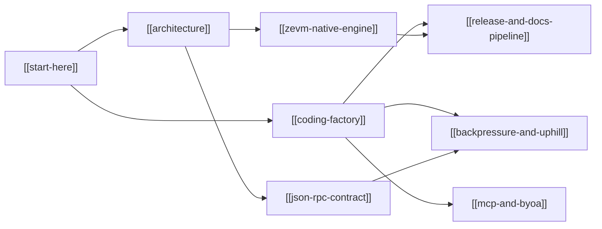

# TEVM Engineering Wiki

Obsidian-compatible knowledge graph for `evmts/tevm`, maintained publicly on [smithers.sh/evmts/tevm](https://smithers.sh/evmts/tevm) and refreshed automatically by `.smithers/workflows/wiki-refresh.ts` on every merge to `main`.

## Core Architecture Pages

- [[start-here]] - 60-second orientation to packages, native ZEVM, and the public coding factory
- [[architecture]] - Layered design from `tevm` facade through `@tevm/memory-client`, `@tevm/actions`, `@tevm/node`, and ZEVM
- [[zevm-native-engine]] - Building, pinning, stamping, and caching native ZEVM, Voltaire, and Guillotine Mini via Smithers
- [[json-rpc-contract]] - Wire contract, canonical hex encoding, negative error codes, and regression proof standards

## Coding Factory and Operations Pages

- [[coding-factory]] - Smithers Cloud workflows, QuickJS realm planning, shared object store cache, and trusted vs untrusted execution
- [[mcp-and-byoa]] - Public authenticated MCP at `https://smithers.sh/evmts/tevm/mcp` and single-use sandbox credentials
- [[backpressure-and-uphill]] - Lighthouse-style Uphill audit covering Footprint, Quality, Architecture, and Factory Health
- [[release-and-docs-pipeline]] - Smithers Cloud to GitHub mirror triggering Changesets npm releases, Vocs docs, and `llms.txt`

## Architecture Decisions

- [[0001-zevm-native-engine]] - Adopting native Zig ZEVM (Guillotine Mini + Voltaire) as the core execution engine
- [[0002-split-privilege-object-store]] - Splitting read and write credentials on the shared Smithers Cloud object store
- [[0003-public-factory-and-lighthouse-backpressure]] - Public TODOs, BYOA MCP, personalized factory UI, and Lighthouse Uphill audits

## Mythical History

Read TEVM's clean from-scratch epic timeline in [`.smithers/history/MYTHICAL.md`](../history/MYTHICAL.md), verified alongside this wiki by `node scripts/factory/verify-wiki.mjs` and `node scripts/factory/mythical-history.mjs --check`.
