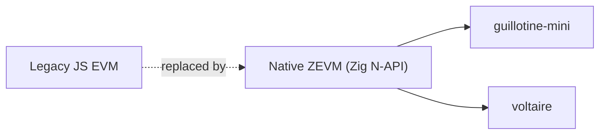

# ADR 0001: Native ZEVM Execution Engine

- **Status**: Accepted
- **Date**: 2026-09-05 (updated 2026-11-26)
- **Related**: [[zevm-native-engine]], [[architecture]]

## Context

Running full Ethereum state transitions, mainnet forks, and Ethereum Execution Spec suites purely in JavaScript created major performance and conformance maintenance overhead.

## Decision

Adopt `@evmts/zevm` (backed by Zig `guillotine-mini` and `voltaire`) as TEVM's native execution backend, pinned explicitly in `factory/native-dependencies.json`, built via Smithers (`//:zevm`), and content-stamped via `factory/native-addon.sha256` so every downstream test and benchmark re-keys cleanly in the shared Smithers Cloud object store.

## Consequences

- Native execution speed and shared spec conformance across the entire TEVM universe (`zevm`, `voltaire`, `guillotine-mini`, `tevm`).
- Every CI runner and local developer host uses `mise.toml` to resolve identical Zig, Bun, and Foundry toolchains.
