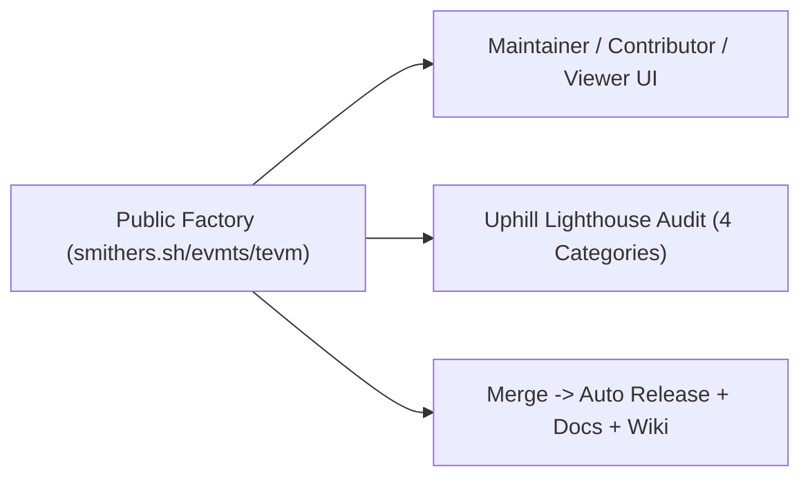

# ADR 0003: Public Coding Factory, Personalized UI, and Lighthouse Backpressure

- **Status**: Accepted
- **Date**: 2026-11-26
- **Related**: [[coding-factory]], [[backpressure-and-uphill]], [[release-and-docs-pipeline]]

## Context

TEVM is switching permanently to public development via Smithers Cloud. Contributors, viewers, and maintainers each need a tailored workspace rather than a one-size-fits-all file tree, and quality backpressure needs to be legible at a glance.

## Decision

1. Make TEVM's factory, TODOs, wiki, mythical history, and authenticated MCP server (`https://smithers.sh/evmts/tevm/mcp`) public.
2. Personalize `.smithers/home.json` and `sites/contributor` across Maintainer, Contributor (1+ contribution), and Viewer roles, embedding the live ZEVM EVM playground directly on the landing view.
3. Present continuous backpressure as a Lighthouse-style Uphill audit report covering Footprint, Quality, Architecture & Testing, and Factory Health.
4. Automatically trigger releases, docs + `llms.txt` publishing, and wiki/mythical history verification whenever changes merge from Smithers Cloud to GitHub `main`.
