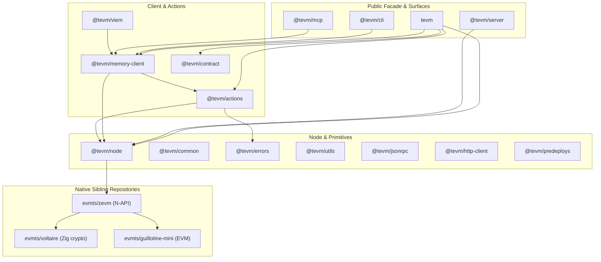

# TEVM Layered Architecture

TEVM separates public developer ergonomics, Viem transport adapters, JSON-RPC handlers, and native EVM execution into lean, independently cached workspace packages.

## Key Invariants

1. **Synchronized facade**: Every public subpath in `tevm/package.json` maps to its facade directory and recursive barrel exports, verified continuously by Uphill's `tevm-facade-exports` metric ([[backpressure-and-uphill]]).
2. **One concept per module**: Production modules stay under 250 lines with functions at or under 70 lines (TigerStyle) and complete JSDoc on exported symbols.
3. **Isolated node state**: Tests and the embedded playground create fresh `createMemoryClient()` instances and dispose native handles with `await client.tevmClose()`.

## Related Pages

- [[start-here]]
- [[zevm-native-engine]]
- [[json-rpc-contract]]
