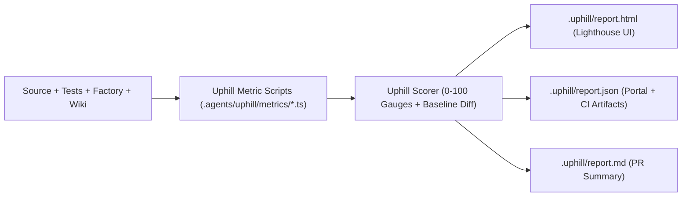

# Lighthouse-Style Backpressure and Uphill Audit

TEVM replaces opaque lint logs with a visual, Lighthouse-style **Backpressure Audit Report** powered by **Uphill** (`.agents/uphill/uphill.yaml`, `.smithers/workflows/uphill.ts`) and embedded directly in the TEVM Factory Portal.



## Audit Categories

1. **Footprint**: Package gzipped source bytes (<= 12 kB core target), production module line cap (<= 250 lines), and minimal direct runtime dependencies (<= 3 per core package).
2. **Quality**: Zero `: any` / `as any`, zero `@ts-ignore` / `@ts-expect-error`, zero stray `console.log` in `packages/`, zero unresolved `TODO`/`FIXME` comments, TigerStyle <= 70-line functions, and complete JSDoc on exported symbols.
3. **Architecture & Testing**: >= 80% test-to-source ratio per workspace package, 100% synchronized `tevm/package.json` facade exports, and 100% valid relative Markdown links across top-level docs.
4. **Factory & Trust Health**: Trust boundary / cache-poisoning audit, QuickJS Realm validity of all `.smithers/workflows/*.ts`, `.smithers/home.json` schema validity, `.smithers/wiki/` link integrity, `.smithers/history/mythical.json` parity, and live ZEVM playground readiness.

## Running Locally

```sh
uphill check
uphill --compact
uphill --compare HEAD --compact
```

Every change must leave Uphill category scores equal or higher than baseline, with top `+N` score opportunities surfaced directly in the Lighthouse UI.

## Related Pages

- [[coding-factory]]
- [[json-rpc-contract]]
- [[0003-public-factory-and-lighthouse-backpressure]]
