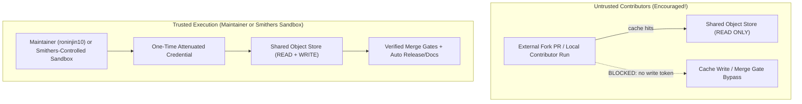

# Smithers Cloud Coding Factory and Trust Boundary

`evmts/tevm` runs publicly on **Smithers Cloud** at [smithers.sh/evmts/tevm](https://smithers.sh/evmts/tevm), mirrored two-way with GitHub and backed by the shared **Smithers Cloud object store** at `https://build.smithers.sh`.

## Core Factory Declarations

- `.smithers/FACTORY.ts` is the single source of truth for flows, triggers, trust policy, and the personalized home UI.
- `scripts/factory/project-factory.mjs` projects `.smithers/FACTORY.ts` deterministically into `.smithers/factory.json` (`apiVersion: 1` with `contributes.triggers` plus `flows[]`) and `.smithers/home.json`.
- Every cloud workflow under `.smithers/workflows/*.ts` is statically and dynamically verified by `scripts/factory/verify-cloud-workflows.mjs` against Smithers Cloud's QuickJS `Realm` planner contract (allowed imports only, <= 64 KiB, valid job DAG).

## Execution Trust Model

1. **Trusted execution**: Only runs executed inside Smithers-controlled sandboxes or by maintainers (`roninjin10`) can hold `SMITHERS_CACHE_WRITE_TOKEN`, populate the shared object store, or satisfy required merge gates.
2. **Untrusted execution**: Non-maintainers are welcomed and encouraged to execute builds, tests, and audits locally or in untrusted sandboxes. They receive read-only shared cache hits (`SMITHERS_CACHE_READ_TOKEN`), zero publish/write secrets, and their results are marked untrusted so they can never poison the shared object store or skip gates.
3. **Root-input-tracing enforcement**: `scripts/factory/trust-boundary.mjs` audits `WORKSPACE.ts`, `factory/policy.json`, `.smithers/factory.json`, and every `.github/workflows/*.yml` on every CI run.

## Personalized Factory UI

The repository home (`.smithers/home.json`) and the public Factory Portal (`sites/contributor`) adapt to three audiences:

- **Maintainer**: Control plane with branch creation, issue triage, TODO stack, CI/Lighthouse/release runs, and governance links.
- **Contributor** (anyone with at least one contribution / repo role): Fast local setup, BYOA MCP setup, contributor flows, public engineering surfaces, and codebase ask bar.
- **Viewer** (`everyone`): Flagship TEVM product overview, live embedded ZEVM playground, runnable TypeScript example, core packages, ecosystem, and releases.

## Related Pages

- [[start-here]]
- [[mcp-and-byoa]]
- [[backpressure-and-uphill]]
- [[release-and-docs-pipeline]]
- [[0002-split-privilege-object-store]]
- [[0003-public-factory-and-lighthouse-backpressure]]
