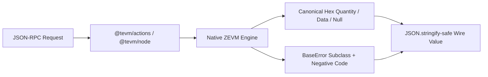

# JSON-RPC Wire Contract and Error Model

Every JSON-RPC endpoint in TEVM (`eth_*`, `tevm_*`, `anvil_*`, `debug_*`) obeys a strict wire contract verified by regression tests and PR-history-derived agentic lints (`//:rpcContractLint`, `//:regressionProofLint`).

## Contract Rules

1. **Exact JSON-serializable wire output**: Responses never leak raw `BigInt`, `Uint8Array`, or non-canonical hex quantities (`0x0` instead of `0x00`, lowercase even-length data hex, explicit `null` where Ethereum JSON-RPC requires it).
2. **Structured errors**: All public errors extend the repository `BaseError` hierarchy in `@tevm/errors`, carrying standard JSON-RPC negative codes (`-32601` Method not found, `-32602` Invalid params, `3` Execution reverted with revert data) and diagnostic context without exposing secrets.
3. **Equivalent input coverage**: Regression tests assert exact wire values across equivalent representations (checksummed vs lowercase addresses, block tag strings vs hex block numbers, padded vs minimal quantity inputs) and prove isolated client state.

## Related Pages

- [[architecture]]
- [[backpressure-and-uphill]]
