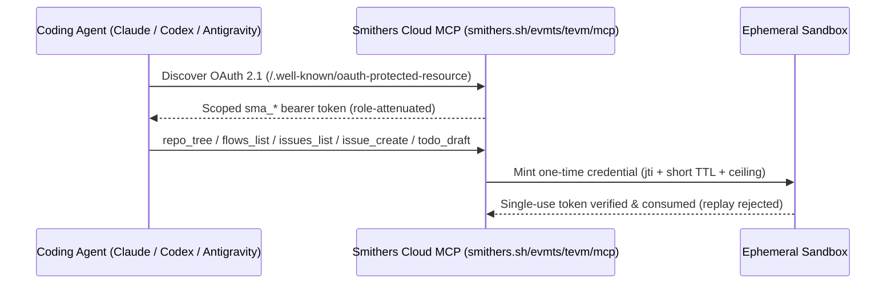

# Public Authenticated MCP and One-Time Sandbox Auth

Agents working on TEVM interact with Smithers Cloud exclusively through the public authenticated Streamable HTTP MCP server at `https://smithers.sh/evmts/tevm/mcp`, while sandboxes receive single-use attenuated credentials.



## Connecting Your Own Agent (BYOA)

```sh
claude mcp add tevm --transport http https://smithers.sh/evmts/tevm/mcp
codex mcp add tevm --url https://smithers.sh/evmts/tevm/mcp
agy mcp add tevm --transport http https://smithers.sh/evmts/tevm/mcp
```

Every MCP write is attributed as `<login> (agent)` and runs under the caller's live role. Person-only actions (merging PRs, final issue triage, committing TODOs, writing secrets) are strictly refused on MCP.

## One-Time Sandbox Authentication

`scripts/factory/sandbox-auth.mjs` provides a zero-dependency helper for minting, printing (redacted by default), and single-use verifying HMAC-SHA256 sandbox tokens (`smthrs_ot_*`):

- **Single-use replay protection**: Each token carries a random `jti` consumed on first verification.
- **Role-based capability ceiling**: `maintainer` and `smithers-sandbox` roles may hold `cache:write` and `gates:attest`. The `untrusted-contributor` role is hard-blocked from requesting `cache:write`, `gates:attest`, `secrets:read`, or `release:publish`.
- **Safe secret handling**: Signing keys and session cookies are read only from environment variables or `0600` files, never from `argv`.

## Related Pages

- [[coding-factory]]
- [[start-here]]
- [[0002-split-privilege-object-store]]
