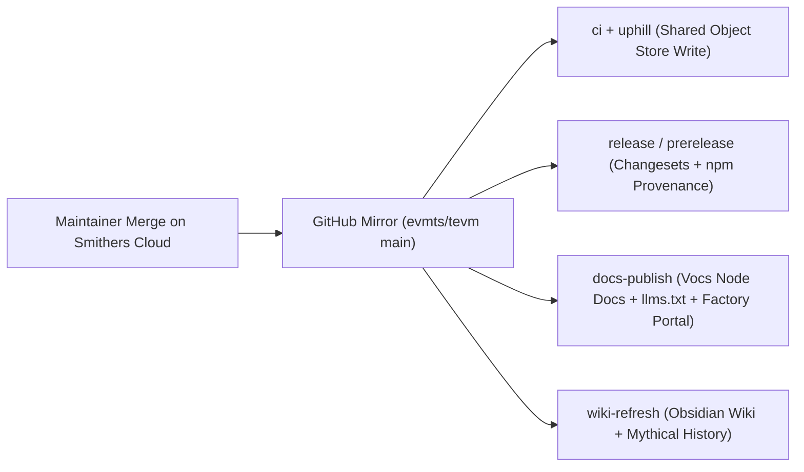

# Automated Release, GitHub Mirror, and Docs Publishing

Merging an approved Change on Smithers Cloud mirrors cleanly to GitHub `main` and automatically drives TEVM's build, release, documentation, and wiki pipelines.

## Release Automation

- **Stable & prerelease continuity**: `.github/PACKAGE.ts` generates `release.yml` and `prerelease.yml` alongside `.smithers/workflows/release.ts`.
  - When `.changeset/pre.json` is absent, pushes to `main` (and `v1`) run the stable Changesets release train (opening/updating the Version Packages PR or publishing approved packages with `NPM_CONFIG_PROVENANCE=true`).
  - When `.changeset/pre.json` is present, pushes to `main` run the prerelease Changesets train.
- **Native ZEVM verification**: Every release verifies `pnpm release:verify` and native addon compatibility before publishing.

## Docs, `llms.txt`, and Factory Portal Publishing

- `scripts/factory/generate-llms-txt.mjs` generates `docs/node/public/llms.txt` from the live Vocs documentation tree so `https://node.tevm.sh/llms.txt` powers Smithers Cloud's Docs tab and MCP `docs_list` / `docs_read`.
- `.github/workflows/docs-publish.yml` (generated from `.github/PACKAGE.ts`) and `.smithers/workflows/docs-publish.ts` build `@tevm/node-docs`, `@tevm/core-docs`, and `@tevm/contributor-portal` on every push to `main` and deploy when trusted credentials are configured.

## Related Pages

- [[coding-factory]]
- [[zevm-native-engine]]
- [[0003-public-factory-and-lighthouse-backpressure]]
