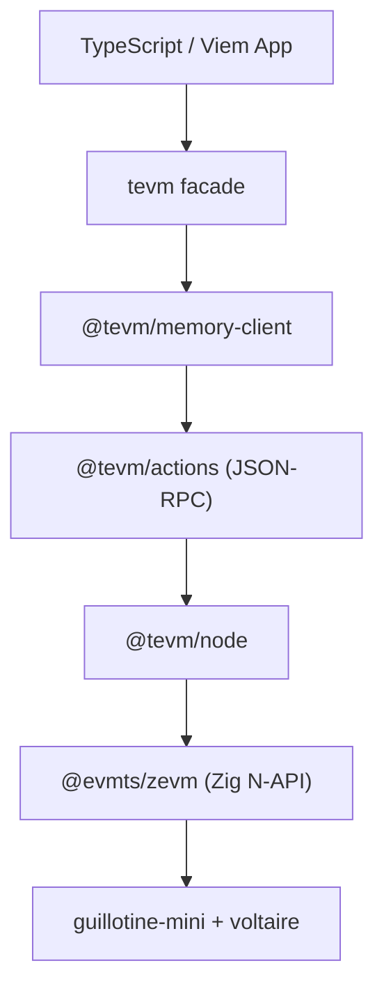

# Start Here

TEVM is a Viem-native, in-memory Ethereum Virtual Machine and full node for TypeScript, backed by the native Zig engine **ZEVM** (combining Guillotine Mini execution with Voltaire cryptography) and built publicly on **Smithers Cloud** at [smithers.sh/evmts/tevm](https://smithers.sh/evmts/tevm).



## Five-Minute Local Onboarding

```sh
pnpm install
pnpm exec smthrs target //:zevm
pnpm exec smthrs target //factory:check
pnpm exec smthrs target //:mechanicalPrePush
uphill --compare HEAD --compact
```

Contributors automatically benefit from read-only hits against the shared Smithers Cloud object store (`https://build.smithers.sh`). Untrusted local and fork runs are encouraged and never poison the shared cache or skip maintainer merge gates.

## Attach Your Coding Agent via MCP

Every agent working on TEVM connects to the public authenticated Smithers Cloud MCP endpoint:

```sh
claude mcp add tevm --transport http https://smithers.sh/evmts/tevm/mcp
codex mcp add tevm --url https://smithers.sh/evmts/tevm/mcp
agy mcp add tevm --transport http https://smithers.sh/evmts/tevm/mcp
```

Use MCP tools to read the tree, inspect flows, open issues, draft TODOs, comment reproduction evidence, and post work links. See [[mcp-and-byoa]] and [[coding-factory]].

## Where to Go Next

- [[architecture]] for package ownership and boundaries
- [[zevm-native-engine]] for building and stamping the Zig native addon
- [[json-rpc-contract]] for wire format and error standards
- [[backpressure-and-uphill]] for the Lighthouse audit metrics
- [[release-and-docs-pipeline]] for how merges to `main` ship automatically
