# Native ZEVM Engine and Smithers Dogfooding

TEVM dogfoods Smithers to build, pin, stamp, and validate its native Zig engine (**ZEVM**), ensuring TypeScript tests and benchmarks always execute against exact, content-addressed native binaries.

```mermaid
flowchart LR
  Pins["factory/native-dependencies.json"] --> Checkout["scripts/factory/checkout-native.mjs"]
  Checkout --> Siblings["../zevm + ../voltaire + ../guillotine-mini"]
  Siblings --> Zig["mise Zig 0.15.2 (zig build npm-native)"]
  Zig --> Addon["zevm.node (native + platform package)"]
  Addon --> Stamp["factory/native-addon.sha256"]
  Stamp --> Cache["Smithers Cloud Object Store (build.smithers.sh)"]
  Cache --> Tests["@tevm/node, playground, parity, benchmarks"]
```

## How Native Pinning Works

- `factory/native-dependencies.json` pins the exact Git revisions of `evmts/zevm`, `evmts/voltaire`, and `evmts/guillotine-mini`.
- `mise.toml` pins `zig`, `bun`, and `foundry` so CI runners, Smithers Cloud sandboxes, and contributor laptops resolve identical tool versions.
- `scripts/factory/build-native.mjs` compiles `zevm.node` in `ReleaseSafe` mode, synchronizes both `../zevm/npm/zevm/native/zevm.node` and the host platform package directory, and writes `factory/native-addon.sha256`.
- Downstream Smithers targets declare `//factory/native-addon.sha256` as an input file so any change to native addon bytes immediately re-keys dependent tests and benchmarks in the shared remote cache.

## Playground and Local Parity

The embedded EVM playground (`.smithers/playground/run.mjs`) loads `createMemoryClient()` directly against the staged native ZEVM addon and verifies deploy, call, arithmetic, storage, revert, and CSP hash integrity in `.smithers/playground/run.test.mjs`.

## Related Pages

- [[architecture]]
- [[coding-factory]]
- [[0001-zevm-native-engine]]
- [[release-and-docs-pipeline]]
